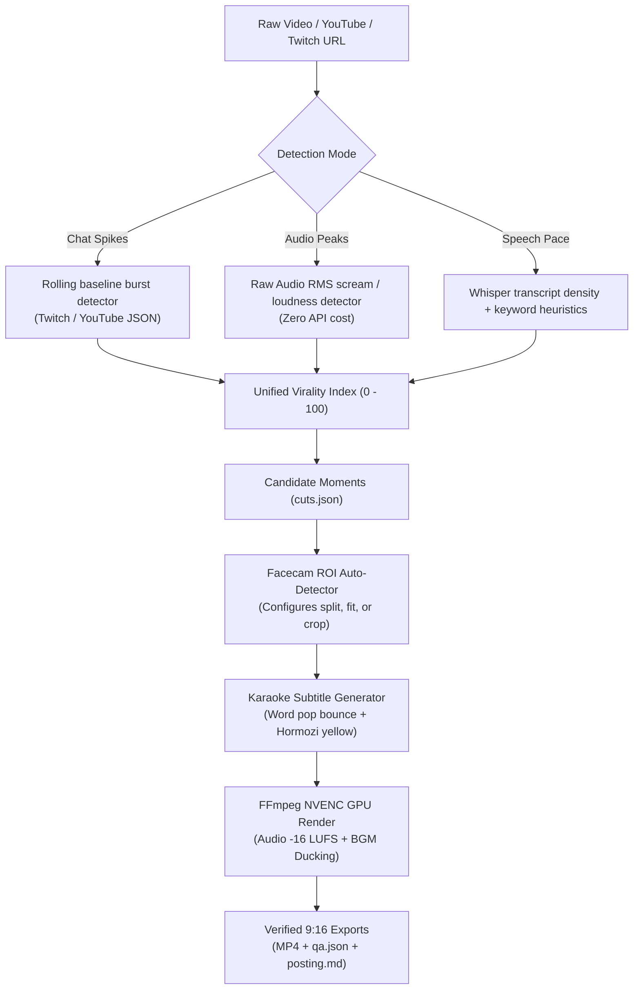

# GTA Clipping & Video-to-Reels Studio

A high-performance, **100% local, zero-API-cost** autonomous editing studio designed to turn long-form Twitch live streams, YouTube VODs, and offline gaming footage into viral vertical 9:16 Shorts, Reels, and TikToks.

Built with Python, FFmpeg, NVIDIA NVENC GPU acceleration, and local OpenAI Whisper. No paid cloud APIs, no external subscriptions.

---

## 🚀 Key Features

* **One-Click End-to-End Automation (`reels.py auto`)**:
  Feed a local video or YouTube/Twitch URL, and the pipeline automatically detects viral moments, transcribes speech, configures vertical framing, renders with GPU acceleration, and verifies technical QA.
* **Hardware-Accelerated Rendering (5×–10× Speedup)**:
  Auto-detects and leverages **NVIDIA NVENC (`h264_nvenc`)**, **Apple Silicon VideoToolbox (`h264_videotoolbox`)**, or **Intel Quick Sync (`h264_qsv`)** with graceful CPU fallback.
* **Streamer Facecam ROI Detection**:
  Scans frames using computer vision to automatically detect the streamer's facecam box and auto-configures a vertical stacked layout (`split`: facecam on top, gameplay on bottom) without manual coordinate guessing.
* **Multi-Modal Virality Detection**:
  * **Chat Burst Velocity (Twitch & YouTube)**: Rolling 5-minute baseline spike multiplier + sentiment keyword/emoji weighting (`💀`, `😂`, `😱`, `🔥`, `CLUTCH`, `DEAD`).
  * **Audio Scream & Energy Spikes**: Analyzes raw audio RMS energy to identify sudden shouting, laughter, explosions, or jumpscares.
  * **Speech Pacing & Punchiness**: Scans word density and dialogue pacing to avoid dead pauses.
* **High-Retention Subtitles & Pop Animation**:
  * **Pop-Bounce Animation**: Words dynamically scale-bounce (`\fscx115\fscy115 -> \fscx100\fscy100`) on screen entry.
  * **Short-Retention Cards**: Configurable 1–3 words per card (MrBeast / Hormozi style) to maximize viewer retention.
  * **Presets**: `hormozi` (Yellow & black shadow), `neon` (Electric green), `classic` (Clean white), and `boxed` (High-contrast background).
  * **Contextual Emojis & Keyword Accents**: Highlights key words and inserts reaction emojis based on sentiment.
* **Background Music (BGM) Auto-Ducking**:
  Mixes background music with automated sidechain compression, smoothly dipping music volume by 12–18 dB whenever the streamer speaks.
* **Interactive Web Studio (`web_ui.py`)**:
  A local browser-based dashboard to scrub video timelines, inspect facecam detection, preview subtitle presets, and render reels with live terminal progress.

---

## ⚡ Architecture & Workflow



---

## 🛠️ Quick Start

### 1. Prerequisites
* Python 3.9+
* FFmpeg (with NVENC support on NVIDIA machines)
* GPU-accelerated Whisper (`pip install faster-whisper` or `openai-whisper`)
* (Optional for URL downloads) `yt-dlp` (`pip install yt-dlp`)

### 2. Option A: Interactive Web Dashboard

Launch the visual web studio:
```bash
python web_ui.py
```
Open **[http://127.0.0.1:8000](http://127.0.0.1:8000)** in your browser to inspect facecams, scan moments, and render with one click.

---

### 3. Option B: One-Command CLI Auto Pipeline

Extract the top 5 viral vertical reels from a local video:
```bash
python skills/video-to-reels/scripts/reels.py auto \
  --video "gameplay.mp4" \
  --count 5 \
  --preset hormozi \
  --out "reels_output/my_reels"
```

Ingest directly from a YouTube or Twitch stream URL:
```bash
python skills/video-to-reels/scripts/reels.py auto \
  --url "https://youtube.com/watch?v=..." \
  --count 5 \
  --preset neon \
  --out "reels_output/stream_reels"
```

With chat logs and background music auto-ducking:
```bash
python skills/video-to-reels/scripts/reels.py auto \
  --video "stream.mp4" \
  --chat "chat.json" \
  --bgm "music.mp3" \
  --bgm-volume 0.20 \
  --count 5 \
  --out "reels_output/chat_clips"
```

---

### 4. Option C: Modular CLI Commands

Run individual stages of the pipeline:

```bash
# 1. Detect Streamer Facecam ROI:
python skills/video-to-reels/scripts/reels.py detect-facecam --video "gameplay.mp4"

# 2. Detect Audio Screams / Volume Peaks:
python skills/video-to-reels/scripts/reels.py detect-audio-spikes --video "gameplay.mp4" --top 10

# 3. Detect Chat Burst Spikes (Twitch / YouTube):
python skills/video-to-reels/scripts/reels.py find-chat-spikes --chat "chat.json" --top 10 --out cuts.json

# 4. Transcribe Speech (Auto-selects CUDA GPU if available):
python skills/video-to-reels/scripts/reels.py transcribe --video "gameplay.mp4" --out transcript.json --device auto

# 5. Render Vertical Reels with NVENC GPU Acceleration:
python skills/video-to-reels/scripts/reels.py render --video "gameplay.mp4" --manifest cuts.json --out reels_output/export --encoder auto

# 6. Verify Technical Compliance (ffprobe decode QA):
python skills/video-to-reels/scripts/reels.py verify --folder reels_output/export
```

---

## 📂 Output Structure

Each exported reel package contains:
```
reels_output/export/
├── 01_Viral_Clip.mp4        # Rendered 1080x1920 vertical video (faststart enabled)
├── 01_Viral_Clip.ass        # Styled ASS subtitles with word pop bounce & karaoke
├── cuts.json                # Complete execution manifest
├── transcript.json          # Word-level Whisper timestamps
├── qa.json                  # Automated FFprobe technical verification report
├── render_report.json       # Encoding metrics and timings
└── posting.md               # Social title, caption, and hashtags ready to copy
```

---

## 🧪 Testing

Run automated tests:
```bash
pytest -v tests/
```

---

## 📄 License

MIT License. Free to use and customize.
